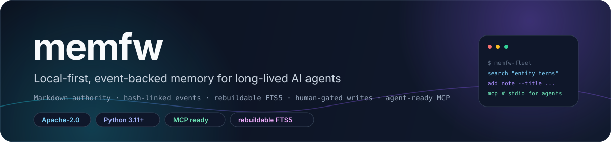
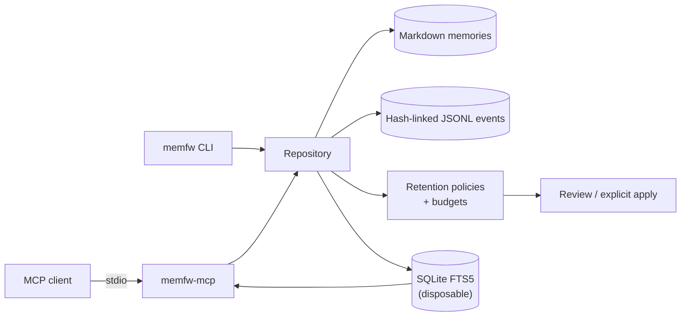

<div align="center">



# memfw

**A long-term memory for AI agents that you can read, diff and trust.**

Markdown is the source of truth · hash-linked JSONL events · rebuildable FTS5 · deterministic retention · local MCP server.

[**简体中文**](README.zh-CN.md) · **English**

<a href="LICENSE"></a>
<a href="https://www.python.org/"></a>
<a href="docs/"></a>
<a href="docs/"></a>
<a href="#-evaluation-summary"></a>

</div>

## What is memfw?

memfw gives AI agents a long-term memory you can actually inspect:

- Every memory is a plain **Markdown file** in a folder.
- Every change is recorded in a **tamper-evident log**.
- Search runs on an **index you can rebuild at any time**.

Agents read and write through a local **MCP server**. Nothing a model writes becomes permanent until a person approves it.

**Why use it**

- **It's just files.** You can open, grep, diff and version your agent's memory like any other notes.
- **Nothing silent.** Model writes need confirmation. Forgetting follows deterministic, reviewable policies, never a hidden model call.
- **Works with any MCP client.** Claude Code, Codex, Cursor and others. It runs offline, and no model is required.
- **Verifiable history.** `memfw log verify` proves the local history is intact.

**How it works**

```
agent ──MCP──► memfw ──► Markdown vault (source of truth)
                            ├─► hash-linked event log (audit)
                            └─► FTS5 index (search; rebuildable)
```

memfw is the engine only. It makes no assumptions about hosts, SSH or external search backends; those belong to the application that uses it.

## ✨ Features

- **Markdown is the authority.** No opaque database to migrate or export.
- **Hash-linked audit log.** Every state change is appended to a JSONL event chain.
- **Rebuildable search.** Lose the FTS5 index and `memfw index rebuild` restores it from Markdown.
- **Natural-language queries.** Each query word is matched on its own and ranked by bm25, so a whole sentence finds relevant memories.
- **Concepts and aliases.** One canonical concept per thing, with aliases (`memfw concepts`), so searching any alias finds every memory about that concept.
- **Deterministic retention.** Five policies (`fifo`, `lru`, `decay`, `salience`, `consolidate_then_forget`), with budgets and reviewable plans.
- **Human-gated writes.** Model writes need confirmation, and anchor decisions stay with a person.
- **Local MCP server.** `memfw-mcp` serves search/get/remember/status over stdio for one vault.
- **OKF export.** Export a vault as a standards-based OKF v0.2 bundle.

## 🧠 Architecture



The implementation lives under [`src/memfw`](src/memfw): `core` owns repository state, `storage` and
`log` persist content and events, `index` and `retrieval` provide search, `policies` and `budget`
plan retention, `curation` handles review workflows, `capture` stages candidates, and `agents`
contains optional adapters. The local MCP server is in [`src/memfw/mcp`](src/memfw/mcp).

## 🚀 Quick start

**Requirements:** Python 3.11+.

```sh
git clone <this-repository>
cd memfw
python -m venv .venv
. .venv/bin/activate
pip install -e .
```

Create a small local vault and query it:

```sh
memfw init localdata/demo-vault
memfw add --root localdata/demo-vault \
  --id note-1 --title 'Local demo' --body 'The greenhouse sensor reports 18 degrees.'
memfw index rebuild --root localdata/demo-vault
memfw index search greenhouse --root localdata/demo-vault
memfw log verify --root localdata/demo-vault
```

Run the local MCP server against that vault:

```sh
memfw-mcp --root localdata/demo-vault
```

Example client configuration (stdio):

```json
{
  "mcpServers": {
    "memfw": {
      "command": "memfw-mcp",
      "args": ["--root", "/path/to/your/vault"]
    }
  }
}
```

## 🤖 MCP tools

| Tool | Purpose |
|---|---|
| `memory_search` | Search the vault: FTS5 by default, optional NotesRetriever hybrid when an embedding endpoint is configured; supports `mode`, `source`, `include_history`, `as_of` |
| `memory_get` | Read one memory by id (read-only) |
| `memory_remember` | Stage a candidate under `_candidates/remember/` with tags/related/suggestions; never writes the vault |
| `memory_related` | Read derived related-memory edges (read-only) |
| `memory_context` | Token-budgeted resident context: anchors and procedural memories first |
| `memory_status` | Vault size, layer/tier counts, and log summary |

The server is deliberately local-only: no SSH, no remote host, no external search backend. If you
need those, build them in your application or adapter.

## 📚 OKF projection

Export the vault as an [Open Knowledge Format v0.2](https://github.com/GoogleCloudPlatform/open-knowledge-format)
bundle for interoperable, frontmatter-driven knowledge consumption:

```sh
memfw okf export ./okf-bundle --root ./localdata/demo-vault --force
memfw okf validate ./okf-bundle
```

The bundle is derived and rebuildable; Markdown remains the authority. See
[`docs/okf.md`](docs/okf.md) for the field mapping and validation rules.

## 📊 Evaluation summary

| Signal | Result |
|---|---|
| Corpus processed | 10 conversations · 5,882 turns · 1,986 questions |
| Questions with valid evidence | 1,982 |
| Retention policies compared | FIFO, LRU, decay, salience, consolidate-then-forget |
| Overall adjusted contrasts | **0 / 40** significant (4 scopes × 10 pairwise, Holm adjusted) |
| Retrieval ceiling (full-corpus BM25, 128-token) | **36.56%** evidence recall vs. **95.04%** query-conditioned oracle |
| Local Mem0 baseline (n=18) | memfw 66.7% vs. Mem0 62.5% evidence recall @100%; no significant difference |

These are **bounded negative results**, not quality claims: small samples, single-repeat runs, and a
logical retention projection rather than a physical-vault capacity test.

- **Full evidence and limitations:** [`docs/evaluation.md`](docs/evaluation.md)
- **Day 7 report (LoCoMo):** [`reports/day7_report.md`](reports/day7_report.md)
- **Day 10 null-result analysis:** [`reports/day10_null_result_analysis.md`](reports/day10_null_result_analysis.md)
- **Day 11 Mem0 baseline:** [`reports/day11_baseline_comparison.md`](reports/day11_baseline_comparison.md)
- **Step G experiment:** [`results/stepG/REPORT.md`](results/stepG/REPORT.md)
- **Dream evaluation data:** synthetic duplicate, conflict and stale cases, plus merge-accuracy,
  conflict-detection and false-merge metrics ([`eval/dreams/`](eval/dreams)). `memfw dream` itself is
  not implemented yet.

## 📁 Repository layout

| Path | Contents |
|---|---|
| `src/memfw/` | repository, storage, hash-linked log, FTS5/hybrid retrieval, retention policies and budgets, curation, capture, agents, local MCP server, code retrieval |
| `eval/`, `scripts/` | evaluation pipelines and the local portfolio demo |
| `reports/`, `results/` | reproducible evaluation reports and artifacts |
| `docs/` | architecture notes, evaluation deep-dive, design notes |
| `tests/` | test suite |
| `NOTICE`, `LICENSE` | attribution and license texts |

## 🛠️ Development

MemFW has no `test` extra; `dev` installs the runtime, the test tools, and `sqlite-vec`:

```sh
uv sync --frozen --extra dev
```

Then, from this environment:

```sh
.venv/bin/python -m pytest -q
.venv/bin/python -m mypy src
.venv/bin/python -m ruff check src/memfw tests
```

The default full suite is `.venv/bin/python -m pytest -q`, with no ignore. MLX transport tests no
longer depend on host load: 054174c stubs `os.getloadavg` for non-guard tests, while the two
explicit load-guard tests still exercise the guard.

For current measured counts and known limitations, see
[`docs/RELEASE-READINESS.md`](docs/RELEASE-READINESS.md).

## 🧭 Design principles and limits

1. **Human > mechanism > model.** Models may propose; deterministic mechanisms validate budgets,
   provenance, and state transitions; a person remains responsible for content and anchor decisions.
2. **Inference is not testimony.** Model-inferred content must be distinguishable from the user's
   own words, with sources and uncertainty preserved.
3. **User data stays local by default.** The core and demo flows do not upload user data.
4. **The core is lexical and model-free; hybrid retrieval is optional.** `memory_search` uses the
   rebuildable FTS5 projection by default. If a local OpenAI-compatible embedding endpoint is
   configured, it delegates to the shared notes hybrid retriever; rerank and query rewrite remain
   default-off. The SQLite projections are rebuildable from Markdown.
5. **Small samples.** The retention evaluation is bounded evidence about one dataset and these
   settings; it is not a claim of production quality or user-level generalization.

## 🧩 More components

Optional pieces built on the same engine: a notes index, code retrieval, the read-only HTTP service, and the relatedness projection. See [`docs/COMPONENTS.md`](docs/COMPONENTS.md).

## 🤝 Contributing

Issues and pull requests are welcome. Before opening a PR:

1. run `pytest -q`, `mypy src`, and `ruff check src/memfw tests`;
2. do not include personal data, credentials, private notes, or real user memories;
3. keep evaluation claims bounded and link the report or artifact that supports them.

## 📄 License

Licensed under the [Apache License 2.0](LICENSE). The Traditional-to-Simplified character map in
`src/memfw/ontology/t2s.py` is derived from [OpenCC](https://github.com/BYVoid/OpenCC) (Apache-2.0);
see [`NOTICE`](NOTICE).
