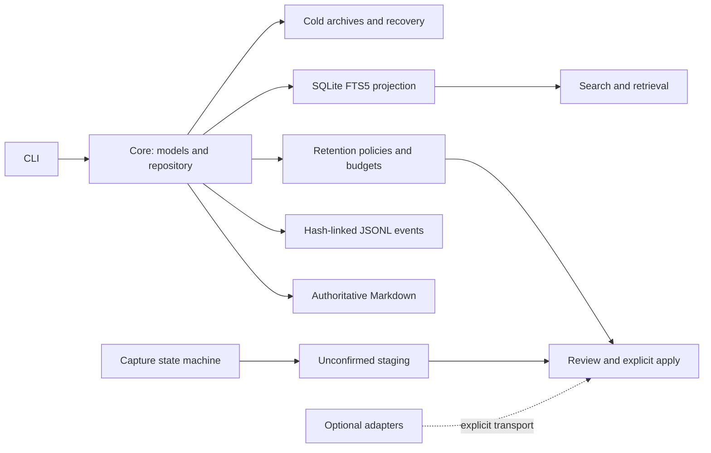

# memfw

个人 AI 和 agent 要长期协作，需要保留有用信息；但本地记忆容量有限，持续累积会挤占空间，也会留下用户不想继续保留的内容。遗忘权和容量管理因此是记忆系统的一部分。

**`memfw` 是本地优先的 Python 记忆库，用可检查的文件和确定性策略管理保留与遗忘。** 它以 Markdown 保存当前记忆，以哈希链 JSONL 事件记录状态变化，并用可重建的 SQLite FTS5 索引提供搜索。核心无需语言模型。项目采用 Apache-2.0 许可证。

## 项目原则

1. **模型写入默认需要人工确认。** 明确授权的规则可按策略自动执行；anchor 决策始终由人作出。
2. **模型推断不等于用户原话。** 推断内容应与直接陈述区分，并保留来源和不确定性。
3. **用户数据默认留在本地。** 核心和演示流程不自动上传用户数据。

## 架构



The implementation is organized under [`src/memfw`](src/memfw): `core` owns repository state, `storage` and `log` persist content and events, `index` and `retrieval` provide search, `policies` and `budget` plan retention, `curation` handles review workflows, and `capture` stages candidates. `agents` contains deterministic and optional adapters. The SQLite index is a projection; Markdown files remain the current content source.

The retention policy names describe different deterministic selection rules; they do not imply a quality ranking.

| Policy | Selection summary |
|---|---|
| `fifo` | Evict oldest created records first. |
| `lru` | Evict records with the oldest recorded access first. |
| `decay` | Rank by age-decayed strength, access, references, review interval, and optional keyness. |
| `salience` | Rank by access, references, optional keyness, and manual marking. |
| `consolidate_then_forget` | Use bounded duplicate proposals before fallback forgetting; proposal application requires explicit review. |

## Quick start

Python 3.11 or newer is required. The example creates a new local vault and adds one synthetic note; it does not need a model or benchmark corpus.

```sh
python -m venv .venv
. .venv/bin/activate
pip install -e .

memfw --now 2026-10-21T12:00:00+00:00 --id-seed demo init localdata/demo-vault
memfw --now 2026-10-21T12:00:00+00:00 --id-seed demo add --root localdata/demo-vault \
  --id note-1 --title 'Local demo' --body 'The greenhouse sensor reports 18 degrees.'
memfw index rebuild --root localdata/demo-vault
memfw index search greenhouse --root localdata/demo-vault
memfw log verify --root localdata/demo-vault
```

Install development tools with `pip install -e '.[dev]'`. The CLI is registered as `memfw`; run `memfw --help` for available commands. Evaluation scripts use explicitly supplied local input files and are separate from this vault quick start.

## LoCoMo evaluation: a bounded negative result

The official local evaluation processed **10 conversations, 5,882 turns, and 1,986 questions**. Of these, **1,982 questions had valid evidence**. It compared five BM25 retention policies: FIFO, LRU, decay, salience, and consolidate-then-forget. The analysis used **1,000 paired bootstrap resamples within each conversation**. Each overall condition/budget scope tested the **10 pairwise policy comparisons** with Holm adjustment.

No overall pairwise contrast was significant after adjustment in the four overall condition/budget scopes. This is a lack of detected overall differences in this evaluation; it does not establish equivalence or prove that the policies have no effect. One category-level contrast passed its within-category adjustment, but category results were not corrected across all categories and scopes. Treat it as exploratory.

| Evaluation item | Result | Evidence |
|---|---:|---|
| Conversations / turns / all questions | 10 / 5,882 / 1,986 | [Report: result and data boundary](reports/day7_report.md#result), [JSON: `sample_count`, `quick_scope`](reports/LARGE_FILES.md) |
| Questions with valid evidence | 1,982 | [Report: evidence normalization](reports/day7_report.md#official-data-and-evaluation-boundary) |
| Bootstrap repeats / resampling unit | 1,000 / questions within 10 conversations | [Report: paired intervals](reports/day7_report.md#evidence-recall-with-paired-95-intervals), [JSON: `bootstrap_repeats`](reports/LARGE_FILES.md) |
| Overall comparison family | 5 policies; 10 pairwise contrasts per scope; Holm adjusted | [Report: paired intervals and overall contrasts](reports/day7_report.md#overall-paired-policy-contrasts), [JSON: `bootstrap`](reports/LARGE_FILES.md) |
| Overall result | 0 significant adjusted contrasts across 4 scopes | [Report: overall contrasts](reports/day7_report.md#overall-paired-policy-contrasts) |

The report measures evidence recall: the share of gold evidence IDs retrieved within a 128-token context. It does not measure answer accuracy. This is a logical retention projection, not a physical-vault capacity test. Consolidation uses deterministic mock proposals and simulated projection semantics. The separate synthetic capture gate did not establish its proposed storage-saving target; see the [gate results and definition](reports/day7_report.md#capture-gate-and-h6). The benchmark uses no answer-generation model or network access. The full [report](reports/day7_report.md#evidence-recall-with-paired-95-intervals) describes these limits and reproducibility. The public repository does not include the corpus; rerunning the evaluation requires a local copy supplied with `--data`.

## Findings (Days 10–11)

Both results are small-sample and **not statistically significant**; read them as bounded evidence, not claims.

- **Why the five forgetting policies looked alike (Day 10).** Budgets did bind, but some policies kept identical memory sets (FIFO and LRU retained the same IDs in 10/10 no-access samples at 10% and 25%), and full-corpus BM25 recalled only 36.56% of evidence within the 128-token context vs. 95.04% for a query-conditioned oracle, so retrieval/context is one plausible ceiling. Under tighter budgets salience diverged from FIFO (5%: 4.36% vs. 2.23% evidence recall, Holm-adjusted exact sign-flip p = 0.0977; 0/10 contrasts significant). This suggests budget pressure is where policies separate, but it is unproven. [Report](reports/day10_null_result_analysis.md)
- **Local Mem0 baseline (Day 11).** Same local model (qwen3.5:9b), embedder (nomic-embed-text), top-k 5 and 128-token context, on 18 questions from one public LoCoMo conversation (first 100 turns). Evidence recall at 100% retention: memfw 66.7% vs. Mem0 62.5%; at 5%: 4.2% vs. 0.0%. Answer score at 100%: 0.459 vs. 0.527. No difference is significant (Holm p ≥ 0.98); power is low (approx. minimum detectable recall difference 15–22 points). [Report](reports/day11_baseline_comparison.md)
- **Provenance is a design trade-off.** In a 30-memory rule-based audit, all 30 memfw memories were verbatim source text; 21/30 Mem0 memories were derived text recorded as `attributed_to=user` without an inference label. Mem0 stores third-person summaries by design, which compress and resolve context; this is a difference in what is stored, not a Mem0 defect. Rules and counts: [reports/day11_baseline_comparison.md](reports/day11_baseline_comparison.md).
- **Human confirmation was not exercised in Day 11.** memfw's budget enforcement ran as the automated mechanism and deleted directly (0 human approvals); Mem0 writes without a confirmation step by design. Human-in-the-loop cost remains unmeasured.

## Small local demo

The optional portfolio demo evaluates only the first sample, its first 100 turns, and up to 20 questions whose complete valid evidence set falls within those turns. It compares five production retention policies at a 25% canonical-body budget with a no-forgetting reference, using production BM25 retrieval. The result is a small subset demonstration, not a full benchmark or a statistical claim. Consolidation is a deterministic mock-proposal projection; it does not invoke a human-approval command. The script requires an explicit local JSON path, rejects known pilot-vault paths, stores its temporary vault outside the project, and writes aggregate counts only.

```sh
python scripts/portfolio_demo.py \
  --data /path/to/local/locomo.json \
  --table \
  --output /tmp/memfw-demo.json \
  --receipt /tmp/memfw-demo-runtime.json
```

The JSON result is deterministic for the same input. On the public first-sample run documented in the [demo report](reports/portfolio_demo_report.md), it processed 100 turns and 20 questions in 1.04 seconds on the reporting machine; this timing is machine-specific, not a performance guarantee. The report includes all six aggregate rows and a repeat-run byte-identity check. The optional runtime receipt is separate. The demo does not copy the corpus into the repository and makes no model or network calls. See the [three-minute recording outline](docs/demo-recording.md).

## Scope and next steps

The project provides local storage, retrieval, retention planning, review, and recovery primitives. The LoCoMo result is bounded evidence about one dataset and these evaluation settings; it is not a claim of production quality or user-level generalization. Next work should focus on clearer adapter boundaries and broader evaluation before making quality claims. Optional adapters can use an external service only when the caller injects a transport; that choice can send data outside the local process and should be explicit.

Older detailed design notes and historical benchmark snapshots remain in [docs/legacy-design-notes.md](docs/legacy-design-notes.md). Use the linked reports for evidence and limitations.

## Step G experiment: memfw vs Mem0 on a fixed public LoCoMo subset

[`results/stepG/REPORT.md`](results/stepG/REPORT.md) is a reproducible, bounded comparison on the
public LoCoMo corpus: one fixed conversation window (`conv-49`, first 100 turns), the 18 questions
defined by the Day 11 manifest, and seed `20261021`. It is an experiment artifact, not a product
claim; read the report's limitations before citing numbers.

- **Arms:** `memfw` (verbatim writes + shared-embedding cosine retrieval), `mem0_stock`
  (stock Mem0 `add(infer=True)`; same default extraction prompt as Day 11, but the context window
  differs — see the report's reproduction section), and `mem0_custom` (a sensitivity arm with
  schema-compatibility extraction instructions).
- **Same answer model and embedder for every arm:** `qwen3.5:9b` + `nomic-embed-text`,
  temperature 0, top-k 5, 128-token context budget.
- **Judging:** primary judge is a different local model (`qwen3.5:4b`); a same-model judge is kept
  as a diagnostic.
- **Bounded result on this subset:** no statistically detectable answer-quality difference between
  the arms (paired exact tests, n=18, MDE ≈ 28 pp); `memfw` writes cost orders of magnitude less;
  Mem0 records derived text as user memories without inference labels in the observed samples.
  An exploratory expanded question set (41 questions in the same window) is reported separately.
- **Expanded check:** an exploratory 41-question set inside the same window (tighter MDE, still no
  significant differences) is included in the report.
- **Cross-framework check:** the same fixed subset is replayed for additional open-source memory
  frameworks (LangMem, MemTensor MemOS in its local `general_text` mode, plus the existing Mem0 arms)
  with an identical answerer/embedder/judge. Framework arms are exploratory single-repeat runs; see
  [`results/stepG/frameworks/FRAMEWORK_COMPARISON.md`](results/stepG/frameworks/FRAMEWORK_COMPARISON.md).
- **Reproduce:** `python eval/stepG_pipeline.py --stage all` (local Ollama models required; see the
  report for the exact environment). Implementation: [`eval/stepG_runner.py`](eval/stepG_runner.py).
