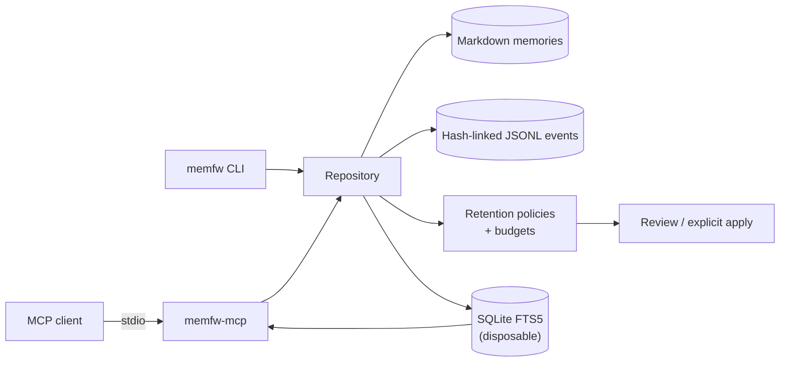

<div align="center">


# memfw

**Local-first, event-backed memory for long-lived AI agents.**

Markdown is the source of truth · hash-linked JSONL events · rebuildable FTS5 · deterministic retention · local MCP server.

[**简体中文**](README.zh-CN.md) · **English**

<a href="LICENSE"></a>
<a href="https://www.python.org/"></a>
<a href="docs/"></a>
<a href="docs/"></a>
<a href="#-evaluation-summary"></a>

</div>

> [!NOTE]
> **Current state.** `memfw` is the reusable memory engine: a local Markdown vault with a
> hash-linked event log, a rebuildable FTS5 projection, deterministic retention policies, and a
> small local MCP server. It intentionally contains **no deployment-specific host, SSH, or search
> backend assumptions** — those belong in the application or adapter that consumes it.

## ✨ Features

- **Markdown is the authority.** Every memory is an inspectable, diffable Markdown file — no opaque
  database to migrate or export.
- **Hash-linked audit log.** Every state change is appended to a JSONL event chain; `memfw log
  verify` proves the local history is intact.
- **Rebuildable FTS5 projection.** Search is a disposable index; lose it and `memfw index rebuild`
  restores it from Markdown.
- **Deterministic retention.** Five selection policies (`fifo`, `lru`, `decay`, `salience`,
  `consolidate_then_forget`), explicit budgets, and reviewable plans — never a silent model call.
- **Human-gated writes.** Model writes require confirmation by default; anchor decisions always
  remain human decisions.
- **Local MCP server.** `memfw-mcp` exposes search/get/remember/status over stdio to any MCP client,
  bound to one local vault directory.
- **No required model.** The core is deterministic and runs offline.
- **OKF projection.** Export a vault as a standards-based, rebuildable OKF v0.2 bundle.

## 🧠 Architecture



The implementation lives under [`src/memfw`](src/memfw): `core` owns repository state, `storage` and
`log` persist content and events, `index` and `retrieval` provide search, `policies` and `budget`
plan retention, `curation` handles review workflows, `capture` stages candidates, and `agents`
contains optional adapters. The local MCP server is in [`src/memfw/mcp`](src/memfw/mcp).

## 🚀 Quick start

**Requirements:** Python 3.11+.

```sh
git clone <this-repository>
cd memfw
python -m venv .venv
. .venv/bin/activate
pip install -e .
```

Create a small local vault and query it:

```sh
memfw init localdata/demo-vault
memfw add --root localdata/demo-vault \
  --id note-1 --title 'Local demo' --body 'The greenhouse sensor reports 18 degrees.'
memfw index rebuild --root localdata/demo-vault
memfw index search greenhouse --root localdata/demo-vault
memfw log verify --root localdata/demo-vault
```

Run the local MCP server against that vault:

```sh
memfw-mcp --root localdata/demo-vault
```

Example client configuration (stdio):

```json
{
  "mcpServers": {
    "memfw": {
      "command": "memfw-mcp",
      "args": ["--root", "/path/to/your/vault"]
    }
  }
}
```

## 🤖 MCP tools

| Tool | Purpose |
|---|---|
| `memory_search` | Search the vault: FTS5 by default, optional NotesRetriever hybrid when an embedding endpoint is configured; supports `mode`, `source`, `include_history`, `as_of` |
| `memory_get` | Read one memory by id (read-only) |
| `memory_remember` | Stage a candidate under `_candidates/remember/` with tags/related/suggestions; never writes the vault |
| `memory_related` | Read derived related-memory edges (read-only) |
| `memory_context` | Token-budgeted resident context: anchors and procedural memories first |
| `memory_status` | Vault size, layer/tier counts, and log summary |

The server is deliberately local-only: no SSH, no remote host, no external search backend. If you
need those, build them in your application or adapter.

## 📚 OKF projection

Export the vault as an [Open Knowledge Format v0.2](https://github.com/GoogleCloudPlatform/open-knowledge-format)
bundle for interoperable, frontmatter-driven knowledge consumption:

```sh
memfw okf export ./okf-bundle --root ./localdata/demo-vault --force
memfw okf validate ./okf-bundle
```

The bundle is derived and rebuildable; Markdown remains the authority. See
[`docs/okf.md`](docs/okf.md) for the field mapping and validation rules.

## 📊 Evaluation summary

| Signal | Result |
|---|---|
| Corpus processed | 10 conversations · 5,882 turns · 1,986 questions |
| Questions with valid evidence | 1,982 |
| Retention policies compared | FIFO, LRU, decay, salience, consolidate-then-forget |
| Overall adjusted contrasts | **0 / 40** significant (4 scopes × 10 pairwise, Holm adjusted) |
| Retrieval ceiling (full-corpus BM25, 128-token) | **36.56%** evidence recall vs. **95.04%** query-conditioned oracle |
| Local Mem0 baseline (n=18) | memfw 66.7% vs. Mem0 62.5% evidence recall @100%; no significant difference |

These are **bounded negative results**, not quality claims: small samples, single-repeat runs, and a
logical retention projection rather than a physical-vault capacity test.

- **Full evidence and limitations:** [`docs/evaluation.md`](docs/evaluation.md)
- **Day 7 report (LoCoMo):** [`reports/day7_report.md`](reports/day7_report.md)
- **Day 10 null-result analysis:** [`reports/day10_null_result_analysis.md`](reports/day10_null_result_analysis.md)
- **Day 11 Mem0 baseline:** [`reports/day11_baseline_comparison.md`](reports/day11_baseline_comparison.md)
- **Step G experiment:** [`results/stepG/REPORT.md`](results/stepG/REPORT.md)

## 📁 Repository layout

| Path | Contents |
|---|---|
| `src/memfw/` | repository, storage, hash-linked log, FTS5/hybrid retrieval, retention policies and budgets, curation, capture, agents, local MCP server, code retrieval |
| `eval/`, `scripts/` | evaluation pipelines and the local portfolio demo |
| `reports/`, `results/` | reproducible evaluation reports and artifacts |
| `docs/` | architecture notes, evaluation deep-dive, design notes |
| `tests/` | test suite |
| `NOTICE`, `LICENSE` | attribution and license texts |

## 🛠️ Development

MemFW has no `test` extra; `dev` installs the runtime, the test tools, and `sqlite-vec`:

```sh
uv sync --frozen --extra dev
```

Then, from this environment:

```sh
.venv/bin/python -m pytest -q
.venv/bin/python -m mypy src
.venv/bin/python -m ruff check src/memfw tests
```

The default full suite is `.venv/bin/python -m pytest -q`, with no ignore. MLX transport tests no
longer depend on host load: 054174c stubs `os.getloadavg` for non-guard tests, while the two
explicit load-guard tests still exercise the guard.

For current measured counts and known limitations, see
[`docs/RELEASE-READINESS.md`](docs/RELEASE-READINESS.md).

## 🧭 Design principles and limits

1. **Human > mechanism > model.** Models may propose; deterministic mechanisms validate budgets,
   provenance, and state transitions; a person remains responsible for content and anchor decisions.
2. **Inference is not testimony.** Model-inferred content must be distinguishable from the user's
   own words, with sources and uncertainty preserved.
3. **User data stays local by default.** The core and demo flows do not upload user data.
4. **The core is lexical and model-free; hybrid retrieval is optional.** `memory_search` uses the
   rebuildable FTS5 projection by default. If a local OpenAI-compatible embedding endpoint is
   configured, it delegates to the shared notes hybrid retriever; rerank and query rewrite remain
   default-off. The SQLite projections are rebuildable from Markdown.
5. **Small samples.** The retention evaluation is bounded evidence about one dataset and these
   settings; it is not a claim of production quality or user-level generalization.

## 🤝 Contributing

Issues and pull requests are welcome. Before opening a PR:

1. run `pytest -q`, `mypy src`, and `ruff check src/memfw tests`;
2. do not include personal data, credentials, private notes, or real user memories;
3. keep evaluation claims bounded and link the report or artifact that supports them.

## 📄 License

Licensed under the [Apache License 2.0](LICENSE). This distribution contains no absorbed third-party
source code; see [`NOTICE`](NOTICE).


## Notes MCP tools

- `notes_search` — FTS/vector/hybrid section search;
- `notes_related` — derived note-to-note edges;
- `notes_get`, `notes_status`;
- `retrieval_feedback`, `retrieval_trace`.

## Notes index

`memfw.notes` is a derived, section-level index for a Markdown notes tree. It is
independent of the memory vault and never writes the notes:

- SQLite FTS5 lexical recall (trigram, or jieba + unicode61 fallback);
- optional sqlite-vec vector recall;
- OpenAI-compatible embedding provider (`HttpEmbeddingProvider`);
- heading/frontmatter chunks, wikilinks, incremental hash-based updates;
- RRF hybrid search with FTS-only degradation.

```bash
memfw notes index --root ~/notes --db /tmp/notes.sqlite \
  --endpoint http://127.0.0.1:8001/v1/embeddings \
  --model qwen3-embedding --dimension 1024
memfw notes search "corpus collocations" --db /tmp/notes.sqlite \
  --endpoint http://127.0.0.1:8001/v1/embeddings \
  --model qwen3-embedding --dimension 1024
memfw notes status --db /tmp/notes.sqlite
memfw notes serve --root ~/notes --db /tmp/notes.sqlite \
  --endpoint http://127.0.0.1:8001/v1/embeddings \
  --model qwen3-embedding --dimension 1024
```

See [Notes index](docs/notes-index.md) for the index layout, MCP server, and
checkpoint/resume behavior.

Install the optional vector extension with `pip install 'memfw[notes]'`.
Without it, the same API still works with full-text search and stores vectors
as a fallback BLOB table.


## Code retrieval

`memfw code` provides an agent-oriented, local code search path without a new service:

- chunks by Python file, top-level function/class (stdlib AST; no tree-sitter required);
- lexical FTS + optional local Qwen3-Embedding + structural definition/caller lookup;
- RRF fusion; lexical+structure fallback when embeddings are unavailable; rerank off;
- lightweight repo map: entry files, directory summary, recent files.

```bash
memfw code index --root . --db /tmp/memfw-code.sqlite
memfw code search "where is VaultRetriever defined" --db /tmp/memfw-code.sqlite
memfw code map --db /tmp/memfw-code.sqlite
```

For semantic code search, add `--embedding-url`, `--embedding-model`, and `--dimension` to
`index` and `search`. Code chunks, symbols, and vectors are disposable projections; source files
remain authoritative.


## V1 integration status

See [`docs/v1-integration.md`](docs/v1-integration.md) for the read-only MemFW V1
surface and the Conductor federation adapter. V1 does not replace Conductor's
proposal/approval lifecycle or write into MemFW automatically.

Conductor v1 (released 2026-11-07) talks to MemFW through the `memfw-http/2`
contract: score, separate read and write tokens, `/stage`, root-only endpoints,
redirect refusal, and a `forget` that says when it is not supported.

**Hardening after the 2026-11-08 memory test** (PRs #15 and #16):

- **Tenant scoping:** `/related` and MCP `memory_related` are tenant-scoped. Tenant and scope are written to the edge table and filtered before the cap, and the live tenant is re-checked before an ID or title is returned. Related reasons keep their real method, and scores are bounded to [0, 1].
- **`memory_remember`:** candidates written in the same second no longer overwrite each other, and every one of them can be applied.
- **Outbound HTTP:** it never follows redirects and never forwards `Authorization`.
- **Notes indexing:** symlinks that escape the notes root are skipped.
- **Reranking:** a caller can no longer choose the rerank endpoint; only the server can configure it.
- **Readonly service:** `scripts/memfw_readonly_service.py` runs standalone with no `memfw` import. [`docs/HA500-UPGRADE.md`](docs/HA500-UPGRADE.md) covers moving an older readonly deployment to `memfw-http/2`, including a `/health` contract check.
- **Field aliases:** `valid_until` and `superseded` are accepted as input aliases of `valid_to` and `superseded_by`. Output always uses the canonical names. A conflicting pair is rejected, and supersession IDs are compared exactly.
- **Test suite:** the full suite on `main` after #16 is 652 passed, 2 skipped (offline; live and network tests excluded).


## Relatedness projection

`memfw.related` builds a disposable edge table from explicit wikilinks/`related`,
shared tags/courses, shared entities, and lexical overlap:

```bash
memfw notes related-build --notes-db /tmp/notes.sqlite --related-db /tmp/related.sqlite
memfw notes related "Week 02/...md" --related-db /tmp/related.sqlite
memfw memory-related-build --root ./vault --related-db /tmp/related.sqlite
memfw memory-related memory-id --related-db /tmp/related.sqlite

memfw notes related-sections-build --notes-db /tmp/notes.sqlite \
  --related-db /tmp/related.sqlite --max-sections 2000
```

Section/item edges carry tenant/scope filters. A 100-pair human annotation CSV
can be generated with `memfw.related_annotation.generate_pairs` and calibrated
with `calibrate` after labels are filled.

The MCP tool `memory_related` exposes memory edges; `notes_related` is available
through the notes MCP when a related DB is configured. Edges are derived, never
write Markdown, and only current memories are indexed.

The optional Conductor write bridge stages a human-approved proposal at the
remote service's non-authoritative `/stage` endpoint; it writes only
`_candidates/` and still requires MemFW human confirmation.

Semantic edges are opt-in: add `--embedding-url`/`--embedding-model` to the
rebuild command and `sqlite-vec` is used for KNN. All indexed sources in one
build share the same embedder/fingerprint. The current QMD coverage uses the
local 4,979-note memfw notes index; remote-only QMD hits are not included until
they have a local vector projection. Semantic scores remain a separate method
and never replace explicit links.
