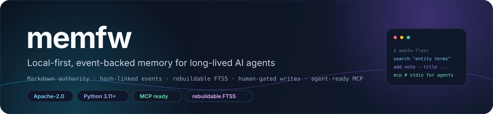

<div align="center">



# memfw

**Long-term memory for AI agents that you can read, diff and trust.**

[简体中文](README.zh-CN.md) · English

<a href="LICENSE"></a>
<a href="https://www.python.org/"></a>
<a href="CHANGELOG.md"></a>

</div>

memfw is a local memory engine for AI agents. Memories are plain Markdown files, every change
goes into a hash-linked event log, and search runs on an index you can rebuild at any time.
Agents use it through an MCP server; people use the `memfw` CLI.

## Features

- **Markdown is the source of truth.** Indexes are derived and disposable; `memfw log verify`
  proves the event chain is intact.
- **One conversation store for every agent.** Readers for 15 agent CLIs and apps feed a local,
  redacted store, so one agent can search and continue another's work.
- **Verify-first consolidation.** Models only stage candidates; a person decides what enters
  the vault.
- **Attachments as evidence.** PDFs, images, audio and video are cited by record; originals stay
  outside the vault.
- **Local-first and private by default.** No model or network in the core; every cloud path and
  every adapter is off until you switch it on.
- **Swappable parts.** A small kernel behind 13 port contracts; search engines (bm25s, Qdrant,
  QMD, …) are separate adapter packages.

## Quick start

Requires Python 3.11+. [uv](https://docs.astral.sh/uv/) is recommended.

```sh
git clone https://github.com/LeoLin990405/memfw.git && cd memfw
uv venv .venv && uv sync --frozen --extra dev
. .venv/bin/activate
```

```sh
memfw init ./demo-vault
memfw add --root ./demo-vault --id note-1 --title 'Local demo' \
  --body 'The greenhouse sensor reports 18 degrees.'
memfw index rebuild --root ./demo-vault
memfw index search greenhouse --root ./demo-vault
```

Connect an MCP client (Claude Code shown; other agents take the same command with their own
`--app`):

```sh
claude mcp add memfw -- memfw-mcp --root /path/to/vault --app claude
```

## How it works

```
agent CLIs / apps ──readers──► conversation store (local, redacted)
        │                              │
        │ MCP                          ├─► summaries, handoff packs
        ▼                              └─► dream: verify · curate · distill (candidates only)
     memfw-mcp ──► vault ◄── human
                    ├─ memories/*.md      source of truth
                    ├─ attachments/*.md   records; originals live outside
                    ├─ events.jsonl       hash-linked audit log
                    └─ index.sqlite3      FTS5, rebuildable
```

## Documentation

| Topic | Document |
|---|---|
| Full guide (commands, MCP tools, privacy, upgrades) | [docs/guide.md](docs/guide.md) |
| Architecture and ports | [docs/architecture.md](docs/architecture.md), [docs/ports-and-recall.md](docs/ports-and-recall.md) |
| Conversations and handoff | [docs/conversations-share.md](docs/conversations-share.md), [docs/handoff.md](docs/handoff.md) |
| Dream | [docs/dream.md](docs/dream.md) |
| Attachments | [docs/attachments.md](docs/attachments.md) |
| Retrieval and health codes | [docs/retrieval-architecture.md](docs/retrieval-architecture.md), [docs/retrieval-health.md](docs/retrieval-health.md) |
| Optional adapters | [docs/COMPONENTS.md](docs/COMPONENTS.md) |
| Evaluation | [docs/evaluation.md](docs/evaluation.md) |
| Release readiness and limits | [docs/RELEASE-READINESS.md](docs/RELEASE-READINESS.md) |
| Changes | [CHANGELOG.md](CHANGELOG.md) |

## Status

Latest release **v0.5.0** (2026-11-20). `main` also carries the unreleased 0.5.1 changes
(conversation session cards, fixed handoff keys, `conversations get --around`). Work for
0.6.0–0.8.0 (bounded recall kernel, memory writing, rerank) is on branches and not yet merged.

**Tests** (aggregates only; private evaluation questions are never published):

| | Result |
|---|---|
| `main`, GitHub Actions, Python 3.11 | 6,831 passed, 46 skipped; `checks` and `standalone-wheels` green |
| Independent acceptance suites on 0.6.0–0.8.0 branches | recall 66/66 · conversations v3 40/44 · memory writing 86/87 · optional components 15/16 |
| Recall kernel, 28-question synthetic bank | strict recall 0.84 vs. 0.52 baseline (Holm-adjusted p = 0.016) |

Evaluation results are bounded and small-sample; see [docs/evaluation.md](docs/evaluation.md).

## Development

```sh
uv sync --frozen --extra dev
pytest -q            # run serially; pytest-xdist gives false failures
mypy src
ruff check src/memfw tests
```

A pull request merges only when every CI check is green.

## Contributing

Issues and pull requests are welcome. Run the checks above first, use synthetic data only (no
personal data, credentials or real transcripts), and back every evaluation claim with a report.

## License

[Apache License 2.0](LICENSE). The Traditional-to-Simplified map in `src/memfw/ontology/t2s.py`
is derived from [OpenCC](https://github.com/BYVoid/OpenCC); see [NOTICE](NOTICE).
