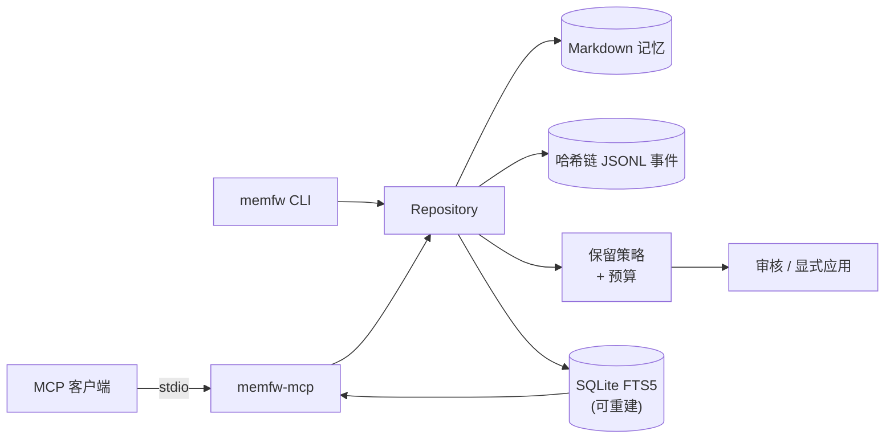

<div align="center">


# memfw

**面向长期 AI Agent 的本地优先、事件溯源记忆引擎。**

Markdown 即真相 · 哈希链 JSONL 事件 · 可重建 FTS5 索引 · 确定性保留策略 · 本地 MCP 服务。

**简体中文** · [**English**](README.md)

<a href="LICENSE"></a>
<a href="https://www.python.org/"></a>
<a href="docs/"></a>
<a href="docs/"></a>
<a href="#-评估结果摘要"></a>

</div>

> [!NOTE]
> **当前状态。** `memfw` 是可复用的记忆引擎：本地 Markdown vault、哈希链事件日志、可重建的
> FTS5 投影、确定性保留策略，以及一个很小的本地 MCP 服务。它**刻意不包含任何部署相关的
> 主机、SSH 或外部检索后端假设**——这些属于消费它的应用或适配器。

## ✨ 特性

- **Markdown 即真相。** 每条记忆都是可读、可 diff 的 Markdown 文件，没有不可迁移的封闭数据库。
- **哈希链审计日志。** 每次状态变化都追加到 JSONL 事件链，`memfw log verify` 可验证本地历史完整。
- **可重建的 FTS5 投影。** 搜索索引是消耗品；即使丢失，`memfw index rebuild` 也能从 Markdown 恢复。
- **确定性保留/遗忘。** 五种策略（`fifo`、`lru`、`decay`、`salience`、`consolidate_then_forget`）、
  显式预算与可审核计划，绝不静默交给模型决定。
- **写入默认需人工确认。** 模型写入默认要确认；anchor 决策始终由人做出。
- **本地 MCP 服务。** `memfw-mcp` 把 search/get/remember/status 以 stdio MCP 暴露给任意客户端，
  只绑定一个本地 vault 目录。
- **不依赖模型。** 核心是确定性逻辑，可完全离线运行。
- **OKF 投影。** 可导出为标准、可重建的 OKF v0.2 bundle。

## 🧠 架构



实现位于 [`src/memfw`](src/memfw)：`core` 负责仓库状态，`storage` 与 `log` 持久化内容与事件，
`index` 与 `retrieval` 提供检索，`policies` 与 `budget` 规划保留，`curation` 处理审核流程，
`capture` 暂存候选，`agents` 包含可选适配器。本地 MCP 服务在
[`src/memfw/mcp`](src/memfw/mcp)。

## 🚀 快速开始

**要求：** Python 3.11+。

```sh
git clone <this-repository>
cd memfw
python -m venv .venv
. .venv/bin/activate
pip install -e .
```

创建本地 vault 并检索：

```sh
memfw init localdata/demo-vault
memfw add --root localdata/demo-vault \
  --id note-1 --title 'Local demo' --body 'The greenhouse sensor reports 18 degrees.'
memfw index rebuild --root localdata/demo-vault
memfw index search greenhouse --root localdata/demo-vault
memfw log verify --root localdata/demo-vault
```

运行本地 MCP 服务：

```sh
memfw-mcp --root localdata/demo-vault
```

客户端 stdio 配置示例：

```json
{
  "mcpServers": {
    "memfw": {
      "command": "memfw-mcp",
      "args": ["--root", "/path/to/your/vault"]
    }
  }
}
```

## 🤖 MCP 工具

| 工具 | 用途 |
|---|---|
| `memory_search` | 检索 vault：默认 FTS5；配置本地 embedding 端点时使用 NotesRetriever hybrid；支持 mode/source/include_history/as_of |
| `memory_get` | 按 id 读取单条记忆（只读） |
| `memory_remember` | 将带有 tags/related/suggestions 的候选暂存到 `_candidates/remember/`，绝不写入 vault |
| `memory_related` | 读取派生的记忆关联边（只读） |
| `memory_context` | 按 token 预算返回常驻上下文：anchor 与 procedural 优先 |
| `memory_status` | vault 规模、layer/tier 统计与日志摘要 |

服务刻意保持本地化：无 SSH、无远程主机、无外部检索后端。需要这些能力时，请在应用或适配器中实现。

## 📚 OKF 投影

可把 vault 导出为 [Open Knowledge Format v0.2](https://github.com/GoogleCloudPlatform/open-knowledge-format)
bundle，便于 Agent 和工具以 frontmatter 消费知识：

```sh
memfw okf export ./okf-bundle --root ./localdata/demo-vault --force
memfw okf validate ./okf-bundle
```

OKF bundle 是可重建的派生投影；Markdown 仍是权威。字段映射与校验规则见
[`docs/okf.md`](docs/okf.md)。

## 📊 评估结果摘要

| 信号 | 结果 |
|---|---|
| 处理语料 | 10 段对话 · 5,882 轮 · 1,986 个问题 |
| 有效证据问题 | 1,982 |
| 对比的保留策略 | FIFO、LRU、decay、salience、consolidate-then-forget |
| 总体校正后显著对比 | **0 / 40**（4 个 scope × 10 个 pairwise，Holm 校正） |
| 检索上限（全语料 BM25，128 token） | 证据召回 **36.56%**，query-conditioned oracle 为 **95.04%** |
| 本地 Mem0 基线（n=18） | memfw 66.7% vs. Mem0 62.5% 证据召回（100% 保留）；差异不显著 |

这些是**有边界的负结果**，不是质量声明：样本小、单次重复、且是逻辑保留投影而非物理 vault 容量实测。

- **完整证据与限制：** [`docs/evaluation.md`](docs/evaluation.md)
- **Day 7 报告（LoCoMo）：** [`reports/day7_report.md`](reports/day7_report.md)
- **Day 10 零结果分析：** [`reports/day10_null_result_analysis.md`](reports/day10_null_result_analysis.md)
- **Day 11 Mem0 基线：** [`reports/day11_baseline_comparison.md`](reports/day11_baseline_comparison.md)
- **Step G 实验：** [`results/stepG/REPORT.md`](results/stepG/REPORT.md)

## 📁 仓库结构

| 路径 | 内容 |
|---|---|
| `src/memfw/` | repository、storage、哈希链日志、FTS5/hybrid 检索、保留策略与预算、curation、capture、agents、本地 MCP 服务、代码检索 |
| `eval/`、`scripts/` | 评估流水线与本地 portfolio demo |
| `reports/`、`results/` | 可复现的评估报告与产物 |
| `docs/` | 架构说明、评估详解、设计笔记 |
| `tests/` | 测试套件 |
| `NOTICE`、`LICENSE` | 署名与许可证文本 |

## 🛠️ 开发

一条命令安装运行时、测试工具和 `sqlite-vec`。开发依赖使用 `dev` extra；项目没有 `test` extra：

```sh
uv sync --frozen --extra dev
```

然后在这个环境里运行：

```sh
.venv/bin/python -m pytest -q
.venv/bin/python -m mypy src
.venv/bin/python -m ruff check src/memfw tests
```

默认完整测试套件命令为 `.venv/bin/python -m pytest -q`，不使用 ignore。MLX transport 测试不再依赖主机负载：提交 `054174c` 为非守卫测试 stub 了 `os.getloadavg`，因此不要求主机处于低负载状态；两个显式负载守卫测试仍会验证守卫的负载拒绝行为。当前实测计数与已知限制见 [`docs/RELEASE-READINESS.md`](docs/RELEASE-READINESS.md)。

## 🧭 设计原则与边界

1. **人 > 机制 > 模型。** 模型可以提议；确定性机制校验预算、provenance 与状态转换；
   内容与 anchor 决策仍由人负责。
2. **推断不是用户原话。** 模型推断内容必须与用户直接陈述可区分，并保留来源与不确定性。
3. **用户数据默认留在本地。** 核心与演示流程不上传用户数据。
4. **核心是词法且不依赖模型；混合检索是可选项。** `memory_search` 默认使用可重建的 FTS5 投影；
   配置本地 OpenAI 兼容 embedding 端点后，才委托共享的 notes 混合检索器。rerank/query rewrite 默认关闭，
   所有 SQLite 投影可从 Markdown 重建。
5. **小样本。** 保留评估只针对一个数据集和这些设置，是有边界的证据，不声明生产质量或用户级泛化。

## 🤝 参与贡献

欢迎 Issue 与 PR。提交前请：

1. 运行 `pytest -q`、`mypy src`、`ruff check src/memfw tests`；
2. 不要包含个人数据、凭据、私密笔记或真实用户记忆；
3. 评估结论保持有边界，并链接支撑它的报告或产物。

## 📄 许可证

使用 [Apache License 2.0](LICENSE)。本发行版不包含吸收的第三方源码；见 [`NOTICE`](NOTICE)。


## Notes MCP 工具

- `notes_search` — FTS/向量/混合 section 检索；
- `notes_related` — 派生的笔记间关联边；
- `notes_get`、`notes_status`；
- `retrieval_feedback`、`retrieval_trace`。

## 笔记索引

`memfw.notes` 是 Markdown 笔记树的派生 section 级索引。它独立于记忆 vault，且绝不写入笔记：

- SQLite FTS5 词法召回（trigram，或 jieba + unicode61 回退）；
- 可选 sqlite-vec 向量召回；
- OpenAI 兼容 embedding 提供方（`HttpEmbeddingProvider`）；
- heading/frontmatter 分块、wikilink、基于 hash 的增量更新；
- RRF 混合检索，可降级为仅 FTS 检索。

```bash
memfw notes index --root ~/notes --db /tmp/notes.sqlite \
  --endpoint http://127.0.0.1:8001/v1/embeddings \
  --model qwen3-embedding --dimension 1024
memfw notes search "corpus collocations" --db /tmp/notes.sqlite \
  --endpoint http://127.0.0.1:8001/v1/embeddings \
  --model qwen3-embedding --dimension 1024
memfw notes status --db /tmp/notes.sqlite
memfw notes serve --root ~/notes --db /tmp/notes.sqlite \
  --endpoint http://127.0.0.1:8001/v1/embeddings \
  --model qwen3-embedding --dimension 1024
```

索引布局、MCP 服务以及检查点/恢复行为见[笔记索引](docs/notes-index.md)。

通过 `pip install 'memfw[notes]'` 安装可选向量扩展。未安装时，同一 API 仍可使用全文检索，并将向量存入回退 BLOB 表。


## 代码检索

`memfw code` 提供面向 Agent 的本地代码检索路径，无需新增服务：

- 按 Python 文件、顶层函数/类分块（标准库 AST，无需 tree-sitter）；
- 词法 FTS + 可选本地 Qwen3-Embedding + 结构化定义/调用方查找；
- RRF 融合；embedding 不可用时回退到词法 + 结构检索；rerank 关闭；
- 轻量级仓库地图：入口文件、目录摘要、最近文件。

```bash
memfw code index --root . --db /tmp/memfw-code.sqlite
memfw code search "where is VaultRetriever defined" --db /tmp/memfw-code.sqlite
memfw code map --db /tmp/memfw-code.sqlite
```

要进行语义代码检索，请在 `index` 和 `search` 命令中添加 `--embedding-url`、`--embedding-model` 和 `--dimension`。代码块、符号和向量都是可丢弃的投影；源文件仍是权威。


## V1 集成状态

只读 MemFW V1 接口与 Conductor 联邦适配器见 [`docs/v1-integration.md`](docs/v1-integration.md)。V1 不替代 Conductor 的提议/批准生命周期，也不会自动写入 MemFW。

Conductor v1（2026-11-07 发布）通过 `memfw-http/2` 契约访问 MemFW。这个契约包括：score、读写分离的 token、`/stage`、只接受根地址、拒绝重定向，以及在不支持 `forget` 时明确说明。


## 关联性投影

`memfw.related` 从显式 wikilink/`related`、共享 tag/课程、共享实体和词法重叠构建可丢弃的边表：

```bash
memfw notes related-build --notes-db /tmp/notes.sqlite --related-db /tmp/related.sqlite
memfw notes related "Week 02/...md" --related-db /tmp/related.sqlite
memfw memory-related-build --root ./vault --related-db /tmp/related.sqlite
memfw memory-related memory-id --related-db /tmp/related.sqlite

memfw notes related-sections-build --notes-db /tmp/notes.sqlite \
  --related-db /tmp/related.sqlite --max-sections 2000
```

section/条目边带有 tenant/scope 过滤器。可用 `memfw.related_annotation.generate_pairs` 生成 100 对人工标注 CSV，并在填写标签后用 `calibrate` 校准。

MCP 工具 `memory_related` 暴露记忆关联边；配置 related DB 后，可通过 notes MCP 使用 `notes_related`。关联边是派生数据，绝不写入 Markdown，且只为当前记忆建立索引。

可选的 Conductor 写入桥接会把人工批准的提议暂存到远程服务的非权威 `/stage` 端点；它只写入 `_candidates/`，并且仍需 MemFW 人工确认。

语义边是可选能力：在重建命令中添加 `--embedding-url`/`--embedding-model` 即可使用 `sqlite-vec` 进行 KNN。同一次构建中的所有索引源共享同一个 embedder/fingerprint。当前 QMD 覆盖使用本地 4,979 篇笔记的 memfw notes 索引；纯远程 QMD 命中在建立本地向量投影前不会纳入。语义分始终是独立方法，绝不替代显式链接。
