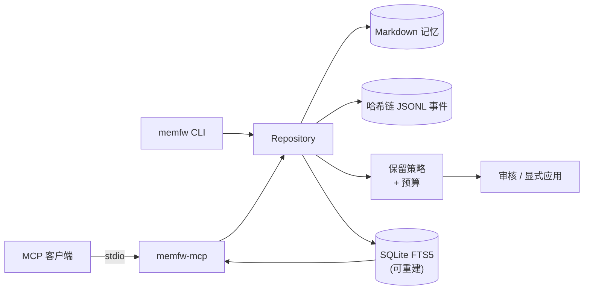

<div align="center">


# memfw

**给 AI agent 一份你看得懂、能 diff、信得过的长期记忆。**

Markdown 即真相 · 哈希链 JSONL 事件 · 可重建 FTS5 索引 · 确定性保留策略 · 本地 MCP 服务。

**简体中文** · [**English**](README.md)

<a href="LICENSE"></a>
<a href="https://www.python.org/"></a>
<a href="docs/"></a>
<a href="docs/"></a>
<a href="#-评估结果摘要"></a>

</div>

## memfw 是什么？

memfw 给 AI agent 一份真正能检查的长期记忆：

- 每条记忆都是文件夹里的一个普通 **Markdown 文件**；
- 每次改动都记在一条**防篡改的日志**里；
- 搜索用的是一个**随时可以重建的索引**。

agent 通过本地 **MCP 服务**读写记忆。模型写的东西，要经过人批准才会生效。

**为什么用它**

- **就是文件。** 你可以像对待普通笔记一样打开、grep、diff，也可以做版本管理。
- **没有暗箱操作。** 模型写入需要确认；遗忘按确定性、可审核的策略进行，从不偷偷调用模型。
- **适用于任何 MCP 客户端。** Claude Code、Codex、Cursor 等都能用；可以完全离线，不需要任何模型。
- **历史可验证。** `memfw log verify` 能证明本地历史完整无缺。

**怎么运作**

```
agent ──MCP──► memfw ──► Markdown vault（唯一真相）
                            ├─► 哈希链事件日志（审计）
                            └─► FTS5 索引（搜索；可重建）
```

memfw 只是引擎，不对主机、SSH 或外部检索后端做任何假设；这些属于使用它的应用。

## ✨ 特性

- **Markdown 即真相。** 没有需要迁移或导出的不透明数据库。
- **哈希链审计日志。** 每次状态变化都追加到 JSONL 事件链。
- **可重建的搜索。** FTS5 索引丢了，`memfw index rebuild` 能从 Markdown 恢复。
- **自然语言查询。** 查询里的每个词分别匹配，按 bm25 排序，一整句话也能找到相关记忆。
- **概念与别名。** 每个东西一个统一概念，并登记别名（`memfw concepts`），用任何一个别名都能找到关于这个概念的所有记忆。
- **确定性保留。** 五种策略（`fifo`、`lru`、`decay`、`salience`、`consolidate_then_forget`），带预算和可审核的计划。
- **写入要人确认。** 模型写入需要确认，anchor 决策始终由人来做。
- **本地 MCP 服务。** `memfw-mcp` 通过 stdio 为一个 vault 提供 search/get/remember/status。
- **OKF 导出。** 可把 vault 导出为标准的 OKF v0.2 bundle。

## 🧠 架构



实现位于 [`src/memfw`](src/memfw)：`core` 负责仓库状态，`storage` 与 `log` 持久化内容与事件，
`index` 与 `retrieval` 提供检索，`policies` 与 `budget` 规划保留，`curation` 处理审核流程，
`capture` 暂存候选，`agents` 包含可选适配器。本地 MCP 服务在
[`src/memfw/mcp`](src/memfw/mcp)。

## 🚀 快速开始

**要求：** Python 3.11+。

```sh
git clone <this-repository>
cd memfw
python -m venv .venv
. .venv/bin/activate
pip install -e .
```

创建本地 vault 并检索：

```sh
memfw init localdata/demo-vault
memfw add --root localdata/demo-vault \
  --id note-1 --title 'Local demo' --body 'The greenhouse sensor reports 18 degrees.'
memfw index rebuild --root localdata/demo-vault
memfw index search greenhouse --root localdata/demo-vault
memfw log verify --root localdata/demo-vault
```

运行本地 MCP 服务：

```sh
memfw-mcp --root localdata/demo-vault
```

客户端 stdio 配置示例：

```json
{
  "mcpServers": {
    "memfw": {
      "command": "memfw-mcp",
      "args": ["--root", "/path/to/your/vault"]
    }
  }
}
```

## 🤖 MCP 工具

| 工具 | 用途 |
|---|---|
| `memory_search` | 检索 vault：默认 FTS5；配置本地 embedding 端点时使用 NotesRetriever hybrid；支持 mode/source/include_history/as_of |
| `memory_get` | 按 id 读取单条记忆（只读） |
| `memory_remember` | 将带有 tags/related/suggestions 的候选暂存到 `_candidates/remember/`，绝不写入 vault |
| `memory_related` | 读取派生的记忆关联边（只读） |
| `memory_context` | 按 token 预算返回常驻上下文：anchor 与 procedural 优先 |
| `memory_status` | vault 规模、layer/tier 统计与日志摘要 |

服务刻意保持本地化：无 SSH、无远程主机、无外部检索后端。需要这些能力时，请在应用或适配器中实现。

## 📚 OKF 投影

可把 vault 导出为 [Open Knowledge Format v0.2](https://github.com/GoogleCloudPlatform/open-knowledge-format)
bundle，便于 Agent 和工具以 frontmatter 消费知识：

```sh
memfw okf export ./okf-bundle --root ./localdata/demo-vault --force
memfw okf validate ./okf-bundle
```

OKF bundle 是可重建的派生投影；Markdown 仍是权威。字段映射与校验规则见
[`docs/okf.md`](docs/okf.md)。

## 📊 评估结果摘要

| 信号 | 结果 |
|---|---|
| 处理语料 | 10 段对话 · 5,882 轮 · 1,986 个问题 |
| 有效证据问题 | 1,982 |
| 对比的保留策略 | FIFO、LRU、decay、salience、consolidate-then-forget |
| 总体校正后显著对比 | **0 / 40**（4 个 scope × 10 个 pairwise，Holm 校正） |
| 检索上限（全语料 BM25，128 token） | 证据召回 **36.56%**，query-conditioned oracle 为 **95.04%** |
| 本地 Mem0 基线（n=18） | memfw 66.7% vs. Mem0 62.5% 证据召回（100% 保留）；差异不显著 |

这些是**有边界的负结果**，不是质量声明：样本小、单次重复、且是逻辑保留投影而非物理 vault 容量实测。

- **完整证据与限制：** [`docs/evaluation.md`](docs/evaluation.md)
- **Day 7 报告（LoCoMo）：** [`reports/day7_report.md`](reports/day7_report.md)
- **Day 10 零结果分析：** [`reports/day10_null_result_analysis.md`](reports/day10_null_result_analysis.md)
- **Day 11 Mem0 基线：** [`reports/day11_baseline_comparison.md`](reports/day11_baseline_comparison.md)
- **“做梦”评测数据：** 合成的重复、冲突、过期用例，以及合并准确率、冲突检出率、误合并率等指标（[`eval/dreams/`](eval/dreams)）。`memfw dream` 本身尚未实现。
- **Step G 实验：** [`results/stepG/REPORT.md`](results/stepG/REPORT.md)

## 📁 仓库结构

| 路径 | 内容 |
|---|---|
| `src/memfw/` | repository、storage、哈希链日志、FTS5/hybrid 检索、保留策略与预算、curation、capture、agents、本地 MCP 服务、代码检索 |
| `eval/`、`scripts/` | 评估流水线与本地 portfolio demo |
| `reports/`、`results/` | 可复现的评估报告与产物 |
| `docs/` | 架构说明、评估详解、设计笔记 |
| `tests/` | 测试套件 |
| `NOTICE`、`LICENSE` | 署名与许可证文本 |

## 🛠️ 开发

一条命令安装运行时、测试工具和 `sqlite-vec`。开发依赖使用 `dev` extra；项目没有 `test` extra：

```sh
uv sync --frozen --extra dev
```

然后在这个环境里运行：

```sh
.venv/bin/python -m pytest -q
.venv/bin/python -m mypy src
.venv/bin/python -m ruff check src/memfw tests
```

默认完整测试套件命令为 `.venv/bin/python -m pytest -q`，不使用 ignore。MLX transport 测试不再依赖主机负载：提交 `054174c` 为非守卫测试 stub 了 `os.getloadavg`，因此不要求主机处于低负载状态；两个显式负载守卫测试仍会验证守卫的负载拒绝行为。当前实测计数与已知限制见 [`docs/RELEASE-READINESS.md`](docs/RELEASE-READINESS.md)。

## 🧭 设计原则与边界

1. **人 > 机制 > 模型。** 模型可以提议；确定性机制校验预算、provenance 与状态转换；
   内容与 anchor 决策仍由人负责。
2. **推断不是用户原话。** 模型推断内容必须与用户直接陈述可区分，并保留来源与不确定性。
3. **用户数据默认留在本地。** 核心与演示流程不上传用户数据。
4. **核心是词法且不依赖模型；混合检索是可选项。** `memory_search` 默认使用可重建的 FTS5 投影；
   配置本地 OpenAI 兼容 embedding 端点后，才委托共享的 notes 混合检索器。rerank/query rewrite 默认关闭，
   所有 SQLite 投影可从 Markdown 重建。
5. **小样本。** 保留评估只针对一个数据集和这些设置，是有边界的证据，不声明生产质量或用户级泛化。

## 🧩 更多组件

基于同一引擎的可选组件：笔记索引、代码检索、只读 HTTP 服务和关联性投影。详见 [`docs/COMPONENTS.zh-CN.md`](docs/COMPONENTS.zh-CN.md)。

## 🤝 参与贡献

欢迎 Issue 与 PR。提交前请：

1. 运行 `pytest -q`、`mypy src`、`ruff check src/memfw tests`；
2. 不要包含个人数据、凭据、私密笔记或真实用户记忆；
3. 评估结论保持有边界，并链接支撑它的报告或产物。

## 📄 许可证

使用 [Apache License 2.0](LICENSE)。`src/memfw/ontology/t2s.py` 中的繁简字符映射取自 [OpenCC](https://github.com/BYVoid/OpenCC)（Apache-2.0）；见 [`NOTICE`](NOTICE)。
