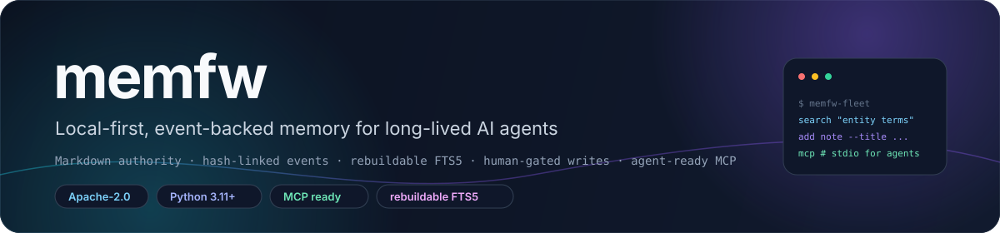
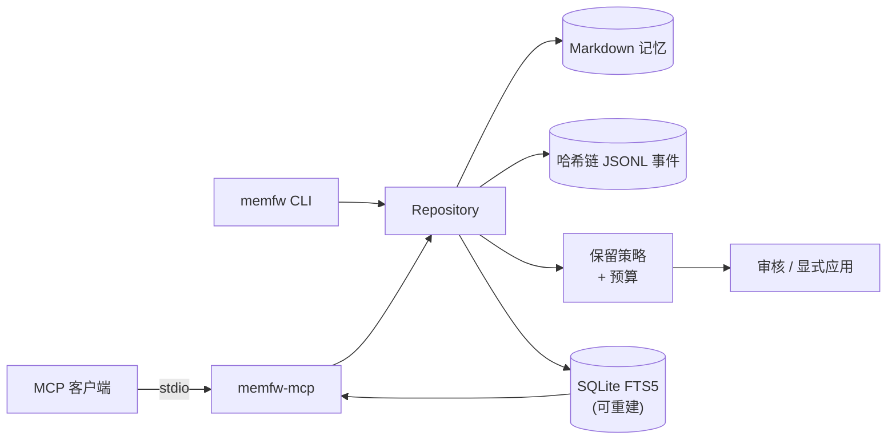

<div align="center">



# memfw

**面向长期 AI Agent 的本地优先、事件溯源记忆引擎。**

Markdown 即真相 · 哈希链 JSONL 事件 · 可重建 FTS5 索引 · 确定性保留策略 · 本地 MCP 服务。

**简体中文** · [**English**](README.md)

<a href="LICENSE"></a>
<a href="https://www.python.org/"></a>
<a href="docs/"></a>
<a href="docs/"></a>
<a href="#-评估结果摘要"></a>

</div>

> [!NOTE]
> **当前状态。** `memfw` 是可复用的记忆引擎：本地 Markdown vault、哈希链事件日志、可重建的
> FTS5 投影、确定性保留策略，以及一个很小的本地 MCP 服务。它**刻意不包含任何部署相关的
> 主机、SSH 或外部检索后端假设**——这些属于消费它的应用或适配器。

## ✨ 特性

- **Markdown 即真相。** 每条记忆都是可读、可 diff 的 Markdown 文件，没有不可迁移的封闭数据库。
- **哈希链审计日志。** 每次状态变化都追加到 JSONL 事件链，`memfw log verify` 可验证本地历史完整。
- **可重建的 FTS5 投影。** 搜索索引是消耗品；即使丢失，`memfw index rebuild` 也能从 Markdown 恢复。
- **确定性保留/遗忘。** 五种策略（`fifo`、`lru`、`decay`、`salience`、`consolidate_then_forget`）、
  显式预算与可审核计划，绝不静默交给模型决定。
- **写入默认需人工确认。** 模型写入默认要确认；anchor 决策始终由人做出。
- **本地 MCP 服务。** `memfw-mcp` 把 search/get/remember/status 以 stdio MCP 暴露给任意客户端，
  只绑定一个本地 vault 目录。
- **不依赖模型。** 核心是确定性逻辑，可完全离线运行。
- **OKF 投影。** 可导出为标准、可重建的 OKF v0.2 bundle。

## 🧠 架构



实现位于 [`src/memfw`](src/memfw)：`core` 负责仓库状态，`storage` 与 `log` 持久化内容与事件，
`index` 与 `retrieval` 提供检索，`policies` 与 `budget` 规划保留，`curation` 处理审核流程，
`capture` 暂存候选，`agents` 包含可选适配器。本地 MCP 服务在
[`src/memfw/mcp`](src/memfw/mcp)。

## 🚀 快速开始

**要求：** Python 3.11+。

```sh
git clone <this-repository>
cd memfw
python -m venv .venv
. .venv/bin/activate
pip install -e .
```

创建本地 vault 并检索：

```sh
memfw init localdata/demo-vault
memfw add --root localdata/demo-vault \
  --id note-1 --title 'Local demo' --body 'The greenhouse sensor reports 18 degrees.'
memfw index rebuild --root localdata/demo-vault
memfw index search greenhouse --root localdata/demo-vault
memfw log verify --root localdata/demo-vault
```

运行本地 MCP 服务：

```sh
memfw-mcp --root localdata/demo-vault
```

客户端 stdio 配置示例：

```json
{
  "mcpServers": {
    "memfw": {
      "command": "memfw-mcp",
      "args": ["--root", "/path/to/your/vault"]
    }
  }
}
```

## 🤖 MCP 工具

| 工具 | 用途 |
|---|---|
| `memory_search` | 检索 vault：默认 FTS5；配置本地 embedding 端点时使用 NotesRetriever hybrid；支持 mode/source/include_history/as_of |
| `memory_get` | 按 id 读取单条记忆（只读） |
| `memory_remember` | 暂存候选到 `_candidates/remember/`，绝不写入 vault |
| `memory_context` | 按 token 预算返回常驻上下文：anchor 与 procedural 优先 |
| `memory_status` | vault 规模、layer/tier 统计与日志摘要 |

服务刻意保持本地化：无 SSH、无远程主机、无外部检索后端。需要这些能力时，请在应用或适配器中实现。

## 📚 OKF 投影

可把 vault 导出为 [Open Knowledge Format v0.2](https://github.com/GoogleCloudPlatform/open-knowledge-format)
bundle，便于 Agent 和工具以 frontmatter 消费知识：

```sh
memfw okf export ./okf-bundle --root ./localdata/demo-vault --force
memfw okf validate ./okf-bundle
```

OKF bundle 是可重建的派生投影；Markdown 仍是权威。字段映射与校验规则见
[`docs/okf.md`](docs/okf.md)。

## 📊 评估结果摘要

| 信号 | 结果 |
|---|---|
| 处理语料 | 10 段对话 · 5,882 轮 · 1,986 个问题 |
| 有效证据问题 | 1,982 |
| 对比的保留策略 | FIFO、LRU、decay、salience、consolidate-then-forget |
| 总体校正后显著对比 | **0 / 40**（4 个 scope × 10 个 pairwise，Holm 校正） |
| 检索上限（全语料 BM25，128 token） | 证据召回 **36.56%**，query-conditioned oracle 为 **95.04%** |
| 本地 Mem0 基线（n=18） | memfw 66.7% vs. Mem0 62.5% 证据召回（100% 保留）；差异不显著 |

这些是**有边界的负结果**，不是质量声明：样本小、单次重复、且是逻辑保留投影而非物理 vault 容量实测。

- **完整证据与限制：** [`docs/evaluation.md`](docs/evaluation.md)
- **Day 7 报告（LoCoMo）：** [`reports/day7_report.md`](reports/day7_report.md)
- **Day 10 零结果分析：** [`reports/day10_null_result_analysis.md`](reports/day10_null_result_analysis.md)
- **Day 11 Mem0 基线：** [`reports/day11_baseline_comparison.md`](reports/day11_baseline_comparison.md)
- **Step G 实验：** [`results/stepG/REPORT.md`](results/stepG/REPORT.md)

## 📁 仓库结构

| 路径 | 内容 |
|---|---|
| `src/memfw/` | repository、storage、哈希链日志、FTS5/hybrid 检索、保留策略与预算、curation、capture、agents、本地 MCP 服务、代码检索 |
| `eval/`、`scripts/` | 评估流水线与本地 portfolio demo |
| `reports/`、`results/` | 可复现的评估报告与产物 |
| `docs/` | 架构说明、评估详解、设计笔记 |
| `tests/` | 测试套件 |
| `NOTICE`、`LICENSE` | 署名与许可证文本 |

## 🛠️ 开发

```sh
python -m venv .venv
. .venv/bin/activate
pip install -e '.[dev]'

pytest -q
mypy src
ruff check src/memfw tests
```

在参考机器上测试结果为 **534 passed、2 skipped**。MLX transport 测试受环境守卫控制
（不满足 MLX 负载条件的机器会跳过），不同机器结果可能不同。

## 🧭 设计原则与边界

1. **人 > 机制 > 模型。** 模型可以提议；确定性机制校验预算、provenance 与状态转换；
   内容与 anchor 决策仍由人负责。
2. **推断不是用户原话。** 模型推断内容必须与用户直接陈述可区分，并保留来源与不确定性。
3. **用户数据默认留在本地。** 核心与演示流程不上传用户数据。
4. **检索按设计是词法的。** FTS5 有真实上限（见评估）；需要语义检索时请在上游接入，
   把这个 vault 当作耐久投影。
5. **小样本。** 保留评估只针对一个数据集和这些设置，是有边界的证据，不声明生产质量或用户级泛化。

## 🤝 参与贡献

欢迎 Issue 与 PR。提交前请：

1. 运行 `pytest -q`、`mypy src`、`ruff check src/memfw tests`；
2. 不要包含个人数据、凭据、私密笔记或真实用户记忆；
3. 评估结论保持有边界，并链接支撑它的报告或产物。

## 📄 许可证

使用 [Apache License 2.0](LICENSE)。本发行版不包含吸收的第三方源码；见 [`NOTICE`](NOTICE)。


## 笔记索引

`memfw.notes` 是一个可重建的 Markdown 笔记 section 级索引，不写入笔记源文件：

- SQLite FTS5 全文检索（trigram，必要时 jieba + unicode61 回退）；
- 可选 sqlite-vec 向量检索；
- 支持 OpenAI-compatible embedding endpoint；
- frontmatter / heading 分块、wikilink、hash 增量；
- RRF 混合排序；embedding 不可用时自动降级为全文检索。

```bash
memfw notes index --root ~/notes --db /tmp/notes.sqlite \
  --endpoint http://127.0.0.1:8001/v1/embeddings \
  --model qwen3-embedding --dimension 1024
memfw notes search "corpus collocations" --db /tmp/notes.sqlite \
  --endpoint http://127.0.0.1:8001/v1/embeddings \
  --model qwen3-embedding --dimension 1024
memfw notes status --db /tmp/notes.sqlite
memfw notes serve --root ~/notes --db /tmp/notes.sqlite \
  --endpoint http://127.0.0.1:8001/v1/embeddings \
  --model qwen3-embedding --dimension 1024
```

安装可选扩展：`pip install 'memfw[notes]'`。
