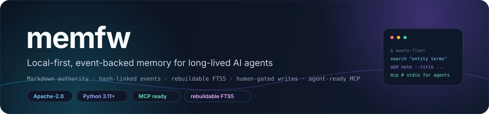

<div align="center">



# memfw

**给 AI agent 用的长期记忆：能读、能 diff、能信。**

简体中文 · [English](README.md)

<a href="LICENSE"></a>
<a href="https://www.python.org/"></a>
<a href="CHANGELOG.md"></a>

</div>

memfw 是一个本地的 agent 记忆引擎。每条记忆是一个普通 Markdown 文件，每次改动都追加到带哈希链的事件日志，
检索用的索引随时可以重建。agent 通过 MCP 服务使用它，人用 `memfw` 命令行。

## 特性

- **Markdown 是唯一真相。** 索引都是派生的，可删可重建；`memfw log verify` 证明事件链完整。
- **所有 agent 共用一个会话库。** 15 个 agent CLI 和应用的读取器汇入一个本地、已脱敏的会话库，一个 agent 可以搜索并接着做另一个的工作。
- **先核对，再整理。** 模型只能提交候选，进不进记忆库由人决定。
- **附件是证据。** PDF、图片、音视频以记录形式被引用，原件放在记忆库之外。
- **本地优先，默认私密。** 核心不调模型、不联网；任何云端路径和适配器都默认关闭。
- **零件可替换。** 小内核加 13 个端口契约；检索引擎（bm25s、Qdrant、QMD 等）是独立的适配器包。

## 快速开始

需要 Python 3.11+，推荐 [uv](https://docs.astral.sh/uv/)。

```sh
git clone https://github.com/LeoLin990405/memfw.git && cd memfw
uv venv .venv && uv sync --frozen --extra dev
. .venv/bin/activate
```

```sh
memfw init ./demo-vault
memfw add --root ./demo-vault --id note-1 --title 'Local demo' \
  --body 'The greenhouse sensor reports 18 degrees.'
memfw index rebuild --root ./demo-vault
memfw index search greenhouse --root ./demo-vault
```

接入 MCP 客户端（以 Claude Code 为例，其他 agent 用同一条命令，换自己的 `--app`）：

```sh
claude mcp add memfw -- memfw-mcp --root /path/to/vault --app claude
```

## 工作方式

```
agent CLI / 应用 ──读取器──► 会话库（本地、已脱敏）
        │                          │
        │ MCP                      ├─► 摘要、交接包
        ▼                          └─► dream：核对 · 整理 · 提炼（只出候选）
     memfw-mcp ──► 记忆库 ◄── 人
                    ├─ memories/*.md      唯一真相
                    ├─ attachments/*.md   附件记录，原件在库外
                    ├─ events.jsonl       哈希链审计日志
                    └─ index.sqlite3      FTS5，可重建
```

## 文档

| 主题 | 文档 |
|---|---|
| 完整指南（命令、MCP 工具、隐私、升级） | [docs/guide.zh-CN.md](docs/guide.zh-CN.md) |
| 架构与端口 | [docs/architecture.md](docs/architecture.md)、[docs/ports-and-recall.md](docs/ports-and-recall.md) |
| 会话与交接 | [docs/conversations-share.md](docs/conversations-share.md)、[docs/handoff.md](docs/handoff.md) |
| Dream | [docs/dream.md](docs/dream.md) |
| 附件 | [docs/attachments.md](docs/attachments.md) |
| 检索与健康码 | [docs/retrieval-architecture.md](docs/retrieval-architecture.md)、[docs/retrieval-health.zh-CN.md](docs/retrieval-health.zh-CN.md) |
| 可选适配器 | [docs/COMPONENTS.zh-CN.md](docs/COMPONENTS.zh-CN.md) |
| 评估 | [docs/evaluation.md](docs/evaluation.md) |
| 发版就绪与限制 | [docs/RELEASE-READINESS.md](docs/RELEASE-READINESS.md) |
| 变更记录 | [CHANGELOG.md](CHANGELOG.md) |

## 现状

最新发版 **v0.5.0**（2026-11-20）。`main` 上还有尚未发版的 0.5.1 改动（会话卡片、固定的交接包字段、
`conversations get --around`）。0.6.0–0.8.0 的工作（有界召回内核、记忆写入、rerank）在分支上，尚未合并。

**测试**（只放汇总数字，私有评测题从不公开）：

| | 结果 |
|---|---|
| `main`，GitHub Actions，Python 3.11 | 6,831 通过，46 跳过；`checks` 和 `standalone-wheels` 全绿 |
| 0.6.0–0.8.0 分支上的独立验收 | 召回 66/66 · 会话 v3 40/44 · 记忆写入 86/87 · 可选组件 15/16 |
| 召回内核，28 题合成题库 | 严格召回 0.84 对基线 0.52（Holm 校正 p = 0.016） |

评估样本小、结论有边界，详见 [docs/evaluation.md](docs/evaluation.md)。

## 开发

```sh
uv sync --frozen --extra dev
pytest -q            # 串行跑；pytest-xdist 会产生假失败
mypy src
ruff check src/memfw tests
```

PR 只有在 CI 全绿后才合并。

## 参与贡献

欢迎 issue 和 PR。提交前先跑上面的检查；只用合成数据（不放个人数据、凭证或真实会话）；任何评估结论都要附报告。

## 许可证

[Apache License 2.0](LICENSE)。`src/memfw/ontology/t2s.py` 中的繁简映射来自 [OpenCC](https://github.com/BYVoid/OpenCC)，见 [NOTICE](NOTICE)。
